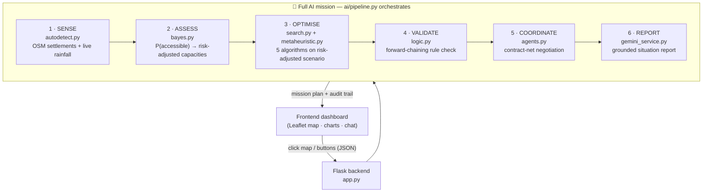

# 🚨 ShelterOps AI — AI-Based Disaster Shelter Allocation

> **Live demo:** https://shelterops-ai-2bgy.zai-ai.site
> *(AI analyst runs in offline mode on the demo unless a Gemini key is configured server-side.)*

A complete **fully-automated AI disaster-planning system**: click any point on the map and it
**detects everything by itself** — real settlements (with OSM population data), real shelter
buildings (hospitals, schools, stadiums), **live rainfall from real weather stations** — then
**searches feasible allocation states**, applies **logical and probabilistic reasoning**,
**coordinates response agents**, **compares modern AI approaches** and produces **grounded
recommendations** on a real OpenStreetMap dashboard. Human effort: two clicks.

| Layer | Tech |
|---|---|
| Backend | Python 3.10+ · Flask (REST API) |
| Frontend | HTML · CSS · vanilla JavaScript · Chart.js + Leaflet (CDN) |
| Map | OpenStreetMap tiles · haversine distances on real lat/lng |
| Auto-detection | **Overpass API** (real OSM settlements/shelters) + **Open-Meteo API** (live rainfall) — both free, no keys |
| AI / LLM | Google **Gemini** API (free tier) + pure-Python AI modules |
| Editor | VS Code (ready-made config included) |

---

## ✨ What the AI actually does

| # | Requirement (project description) | Where it lives |
|---|---|---|
| 1 | **Searches feasible allocation states** | `ai/search.py` — Greedy, Backtracking (Branch & Bound), Hill Climbing; `ai/metaheuristic.py` — Simulated Annealing, Genetic Algorithm |
| 2 | **Logical reasoning** | `ai/logic.py` — rule base (9 Horn-clause rules) + forward chaining to a fixpoint, validates any allocation |
| 3 | **Probabilistic reasoning** | `ai/bayes.py` — Bayesian network (rain → route blocked → shelter accessible) with exact inference by enumeration + risk-adjusted plan |
| 4 | **Coordinates response agents** | `ai/agents.py` — Coordinator / Zone / Shelter / Transport agents negotiating with a contract-net protocol |
| 5 | **Compares modern AI approaches** | `ai/compare.py` — runs all 5 algorithms on one scale (score, coverage, runtime) + convergence charts |
| 6 | **Grounded recommendations** | `ai/gemini_service.py` — Gemini writes the situation report **only from computed data**; smart offline analyst fallback if no API key |
| 7 | **Auto-detection (low human effort)** | `ai/autodetect.py` — one map click → real zones + shelters from OpenStreetMap; live rainfall → auto Bayesian evidence |

**The default scenario — "Uttarakhand Flash Floods"** (Kedarnath-2013 style): evacuees from
real Himalayan towns (Srinagar/Pauri, Kathgodam, Uttarkashi, Kotdwar, Nainital, Mussoorie)
must reach real relief bases (AIIMS Rishikesh, Dehradun FRI Ground, Haridwar Roshanabad,
Haldwani, Rudrapur), with distances computed by haversine formula on actual coordinates.
Mountain geography matters: within the 60 km limit, Srinagar can *only* reach AIIMS
Rishikesh and Uttarkashi *only* Dehradun — so beds must be reserved wisely. Edit
`ai/scenario.py` or the Scenario tab to map your own region.

---

## 🏗️ Architecture — how the AI pipeline connects



Every stage returns its output and timing — the mission result includes the
full audit trail (`stages[]`), so any number in the final report can be
traced back to the module that computed it.

## 📁 Project structure

```
disaster-shelter-ai/
├── app.py                  # Flask server (API + serves frontend)
├── requirements.txt
├── .env.example            # copy → .env, paste your Gemini key
├── ai/
│   ├── scenario.py         # zones, shelters, real lat/lng + haversine distances
│   ├── pipeline.py         # 🚀 orchestrator: sense → assess → optimise → validate → coordinate
│   ├── autodetect.py       # 🛰️ OpenStreetMap + live weather detection
│   ├── search.py           # greedy · backtracking (B&B) · hill climbing · evaluate()
│   ├── metaheuristic.py    # simulated annealing · genetic algorithm
│   ├── logic.py            # forward-chaining rule engine
│   ├── bayes.py            # Bayesian network + exact inference
│   ├── agents.py           # multi-agent contract-net simulation
│   ├── compare.py          # comparison harness
│   └── gemini_service.py   # Gemini API + offline fallback
├── frontend/
│   ├── index.html          # dashboard (6 tabs)
│   ├── style.css
│   └── app.js
└── .vscode/                # F5 debug config + interpreter hint
```

---

## 🖼️ Screenshots

| | |
|---|---|
|  |  |
| *Satellite operations map with allocation flows* | *Five-algorithm benchmark (B&B optimal vs Greedy +69%)* |

## 🚀 Step-by-step setup in VS Code

### Step 1 — Install Python 3.10+ (once)
1. Download from <https://www.python.org/downloads/> (or Microsoft Store: "Python 3.12").
2. **IMPORTANT (installer):** tick ✅ **"Add python.exe to PATH"** before clicking Install.
3. Verify — new terminal (`Ctrl+ù` / Terminal → New Terminal):
   ```
   python --version
   ```

### Step 2 — Open the project
VS Code → **File → Open Folder…** → select `disaster-shelter-ai`.

### Step 3 — Install the Python extension
Extensions sidebar (`Ctrl+Shift+X`) → search **"Python"** (Microsoft) → **Install**.

### Step 4 — Create a virtual environment
Terminal (`` Ctrl+` ``):
```
python -m venv .venv
```
Then `Ctrl+Shift+P` → **Python: Select Interpreter** → choose `.venv (Python 3.x)`.
(The included `.vscode/settings.json` already points at `.venv`.)

### Step 5 — Install dependencies
```
.venv\Scripts\pip install -r requirements.txt
```
*(On PowerShell you may first need: `Set-ExecutionPolicy -Scope CurrentUser RemoteSigned` if scripts are blocked.)*

### Step 6 — Get your FREE Gemini API key (2 minutes)
1. Go to <https://aistudio.google.com/apikey>
2. Sign in with a Google account → **Create API key** → copy it.
3. In the project folder: copy `.env.example` → rename the copy to **`.env`**
4. Open `.env` and replace `your_key_here` with your key.

> No credit card needed. The app **also works without a key** (offline template reports).

### Step 7 — Run!
Either press **F5** (config included), or in the terminal:
```
.venv\Scripts\python app.py
```
Then open **<http://127.0.0.1:5000>** in your browser. 🎉

---

## 🧭 Using the dashboard

| Tab | What to do |
|---|---|
| **Dashboard** | KPIs, **real map** (OpenStreetMap) with zones, shelters, allocation flows and popups, current plan table (auto-runs Greedy at startup) |
| **Scenario** | Edit zones/shelters (population, priority, medical need, real lat/lng), add/remove, save & re-plan |
| **Algorithms** | Run each approach or **Run all & compare** → ranking table, score/coverage charts, convergence curves, B&B search trace |
| **Reasoning** | Logical validation (fired rules + violations) and Bayesian inference (set rain/road/damage evidence → posteriors → risk-aware plan) |
| **Agents** | Contract-net negotiation replayed message by message |
| **AI Report** | One-click grounded Gemini situation report + chat with the AI analyst |

> The map tiles load from openstreetmap.org — an internet connection is needed for the
> basemap (markers/analysis still work offline, just on a plain background).

---

## 🔌 REST API

| Method | Endpoint | Body | Returns |
|---|---|---|---|
| GET | `/api/health` | — | status, Gemini configured? |
| GET | `/api/scenario` | — | default scenario |
| POST | `/api/solve` | `{algo, scenario}` | allocation + metrics + trace |
| POST | `/api/compare` | `{scenario}` | all 5 algorithms ranked |
| POST | `/api/logic` | `{scenario, allocation?}` | facts, fired rules, violations |
| POST | `/api/bayes` | `{scenario, evidence}` | posteriors, risk plan |
| POST | `/api/agents` | `{scenario}` | coordination log + plan |
| POST | `/api/recommendations` | `{scenario, context?}` | grounded AI report |
| POST | `/api/chat` | `{messages, scenario}` | analyst reply |

`algo` ∈ `greedy · hill_climbing · backtracking · simulated_annealing · genetic`

---

## 🧠 How allocation is scored (one scale for all approaches)

```
score = Σ (population × distance × priority_weight)      ← travel cost
      + 200 × unallocated people                         ← must place everyone
      + 200 × over-capacity people                       ← hard constraint
      + 150 × people without required medical shelter    ← hard constraint
      + 60  × people beyond max travel distance          ← soft limit
```

## 🛠️ Troubleshooting

| Problem | Fix |
|---|---|
| `python` not recognized | Reinstall Python with "Add to PATH" ticked, reopen terminal |
| `ModuleNotFoundError: flask` | Activate the venv / run `.venv\Scripts\pip install -r requirements.txt` |
| PowerShell blocks scripts | `Set-ExecutionPolicy -Scope CurrentUser RemoteSigned` |
| Port 5000 busy | Set `PORT=5001` in `.env` and open that URL instead |
| Report says "offline template" | Add `GEMINI_API_KEY` to `.env`, restart the server |
| Map shows grey background | No internet for OSM tiles — reconnect and reload the page |
| Gemini 429 quota | Free-tier rate limit — wait a minute, or use offline mode |

---

## 🌍 How this would be used in real life

> ⚠️ This is a **decision-support prototype** for education/demos — not certified emergency
> software. In a real response, a trained human coordinator always makes the final call.

**Who would use it:** District Emergency Operation Centres (EOC), NDMA/SDMA/SDRF/NGO
coordination teams, and college disaster-management cells — during floods, cloudbursts
and landslide seasons (e.g. Uttarakhand monsoon / Chardham Yatra period).

**🛰️ The automated flow (2 clicks, no data entry):**
1. **🛰️ Auto-detect from map → click anywhere** — the system queries OpenStreetMap and
   builds the entire scenario itself: real settlements (using OSM population tags where
   mapped, ~10 % affected-share heuristic otherwise) and real shelter-candidate buildings
   (hospitals → medical shelters, stadiums, schools…) closest to your click. Priorities
   and medical requirements are assigned automatically.
2. **🛰️ Detect live rain** (*Reasoning tab*) — the system fetches **real current + 24 h
   forecast rainfall** for every zone and shelter (Open-Meteo), converts it into Bayesian
   evidence (rain level, blocked routes) and re-plans risk automatically.
3. Everything else (algorithms, logic validation, agents, AI report) runs on the detected
   data — humans only review and approve the plan.

**The operational loop (matches the app's tabs):**

1. **Input the situation** (*Scenario tab*) — affected zones with population & priority come
   from field reports, revenue/police control rooms, drone surveys and helpline calls;
   shelter capacities come from pre-surveyed buildings (schools, stadiums, dharamshalas)
   in the district's disaster-management plan.
2. **Generate candidate plans** (*Algorithms tab*) — the coordinator clicks *Run all &
   compare*: Greedy gives an instant first answer; Branch & Bound proves the best
   possible plan; SA/GA show how modern optimisation performs at speed.
3. **Validate legality** (*Reasoning tab*) — the logic engine certifies the chosen plan:
   no over-capacity, no medical mismatches, nobody beyond the travel limit. Violations
   are listed as human-readable rules for quick correction.
4. **Update with live intelligence** (*Reasoning tab, Bayesian*) — as IMD rainfall alerts,
   SDRF road reports and damage assessments arrive, the coordinator sets evidence
   (rain = high, "route to S3 blocked") and re-infers which shelters are reachable.
   The risk-adjusted plan shows what is safe to count on *right now*.
5. **Coordinate execution** (*Agents tab*) — the contract-net simulation models how zone
   requests, shelter bids and transport convoys would be negotiated and dispatched,
   with escalations flagged for external relief camps.
6. **Brief decision-makers** (*AI Report tab*) — one click produces a grounded situation
   report (Gemini) or data-driven summary (offline) covering analysis, risk and
   time-phased recommendations for the next 6/24/48 hours.
7. **Repeat every few hours** — disaster response is a rolling process: new inputs in,
   re-optimised plan out, until everyone is sheltered.

**What a production version would add:** a database (not in-memory JSON), live GIS and
river-gauge feeds (IMD, CWC, NRSC satellite flood layers), GPS fleet tracking, user
accounts & audit logs, offline-first field apps, load testing for district scale, and
formal validation with the local disaster-management authority.

**Honest limitations (for the viva):** detection relies on OpenStreetMap coverage (sparse
areas yield fewer features) and population heuristics where OSM lacks tags; road distance ≠
straight-line haversine (a routing API like OSRM would fix this); the Bayesian network is
small; and even a fully-automated system keeps a human approver — that is how real
AI-assisted emergency tools (and Google's crisis alerts) operate.

## 🎓 Presentation notes (viva / report)

- **State space:** each zone → one of S shelters (or unplaced); S^Z states searched systematically by B&B, stochastically by SA/GA.
- **Optimality:** Branch & Bound with an admissible lower bound (min-possible-cost per remaining zone) is *optimal* for small instances — the reference answer other approaches are judged against.
- **Logic:** closed-world Datalog-style forward chaining; 9 rules; fixpoint iteration.
- **Probability:** exact Bayesian inference by enumeration over a small network (rain → routes → accessibility, plus demand surge).
- **Agents:** contract-net protocol (announce → bid → award), deterministic and auditable.
- **LLM grounding:** the LLM receives only computed JSON and is instructed never to invent numbers — compare its report with the offline template to see the difference.

Built as an educational prototype — not for real emergency use.
